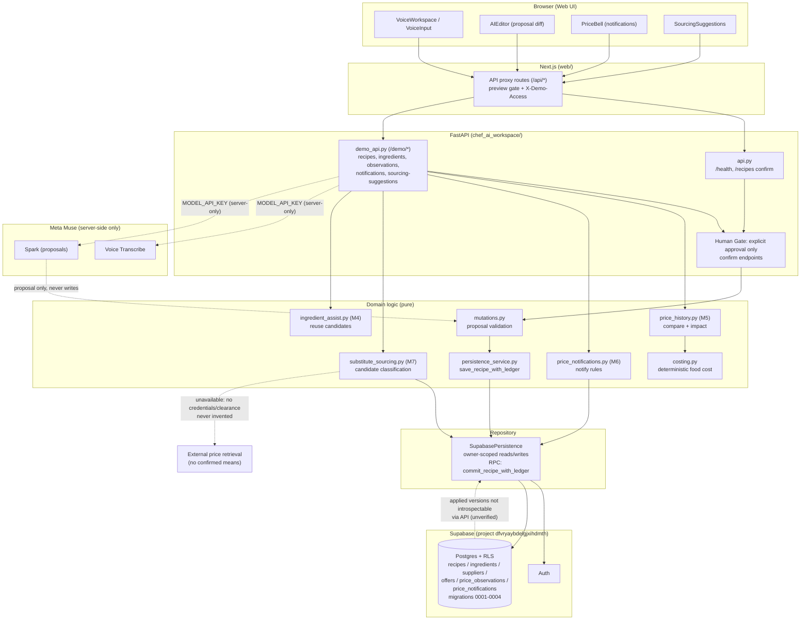

# Chef AI Workspace — system overview (M9)

Maintainable source of the architecture diagram. Dashed edges are
unconnected or unverified paths -- they must not be read as working.

## Data-flow notes

- Voice/text becomes a proposal; the chef's explicit approval is the only
  path to `confirm`/save (Human Gate). Transcription never authorizes.
- SSOT: recipe state, owned ledger rows and saved cost snapshots.
  Reads never adopt prices; notification acknowledgement never switches
  suppliers; suggestions never write.
- Auth boundaries: preview gate (Basic + `DEMO_PREVIEW_PASSWORD`) →
  `X-Demo-Access` demo token → server-only service-role client → RLS
  owner policies. No secret is `NEXT_PUBLIC_`.
- Unverified at M9: live-DB writes, applied-migration status, external
  retrieval, live Meta inference, real-voice runs (see M8_ACCEPTANCE.md).
- Wiring boundary: the voice registration UI saves via `/demo/recipes/full`,
  which creates unlinked material lines (`/api/voice-recipe` carries no
  ingredient IDs or past-recipe context). M4 reuse (search → ingredient-assist
  → ledger confirm) is a demo-API flow, not a voice auto-link. The diagram
  edge DEMO → M4 is that API flow; it must not be read as voice auto-reuse.
